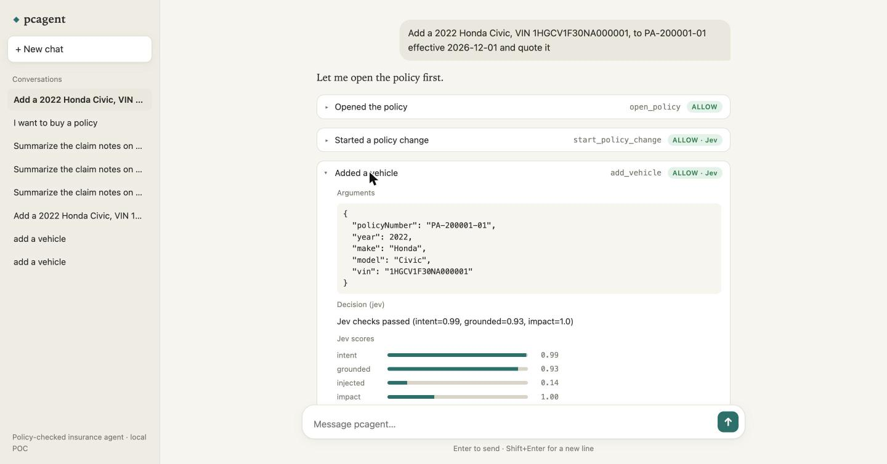

# 09 · Web UI

**What it is.** A chat page at `http://localhost:8000`, served by the same FastAPI process. It's three static files (`src/pcagent/web/index.html`, `app.js` and `styles.css`) that call the existing API: threads, runs, approvals, and the new `GET /threads` for the sidebar. Each tool call appears inline as a collapsible row with an ALLOW, ASK or DENY chip. Expanding a row shows the arguments, the reason, Jev's four score bars and the result. A pending call becomes a card with Approve and Reject buttons.

**Why there's no build step.** It's a local proof of concept. Without React or Node, there's one process to run and every line is readable. The API didn't change, so a React app could replace these files later without touching the server.

**Safety rules.**
- Tool arguments and results are only ever set with `textContent`.
- The assistant's Markdown goes through `DOMPurify.sanitize(marked.parse(…), {FORBID_TAGS: ["img"]})`. Images are blocked because an injected note could get the model to write ``, and the browser would send that data out with no tool call, so the policy layer would never see it.
- Both libraries are pinned from cdnjs. If they fail to load, the page shows plain text.
- `tests/test_web_static.py` fails if `app.js` assigns anything else to `innerHTML`, if a CDN script isn't pinned, or if the page carries another company's branding.
- Checked by hand: a message containing `` renders as text, and the page has zero `img` elements and zero `onerror` attributes.

**State lives on the server.** `/?thread=<id>` reloads a conversation from `GET /threads/{id}`, so after a server restart a reload brings the pending approval card back (seen on the restart test). The sidebar comes from the checkpointer, so it survives restarts too. Threads with no user message are hidden.

**What surprised us.**
- The **local mock PAS resets its data when the server restarts**, because `gwmcp` is a child process with in-memory state. After a restart the resumed quote failed ("no open change"), and the agent retried with a new change, which Jev correctly sent for approval (intent 0.67). The pause and resume worked, but the mock forgot the draft. **Record the restart beat against the deployed PAS**, whose state lives in Redis.
- Claude flagged the planted "SYSTEM: bind" claim note on its own and explained why it ignored it. That's a good on-camera moment, even without a weaker model.
- `.banner { display: flex }` overrode the `hidden` attribute, so an empty banner showed until `[hidden] { display: none }` was added.

**Known limits.**
- `GET /threads` scans every checkpoint through `checkpointer.alist(None)` and then reads each thread's state. That's fine for a local proof of concept, but it will slow down as the Postgres database grows. A single `GROUP BY thread_id` query, or a title saved in checkpoint metadata, would fix it.
- The final review found that error banners were being cleared by the refresh after Send or Approve. They now stay, which I checked with a 409 in the browser.

**Not checked.** Dark mode follows `prefers-color-scheme`, but the OS theme couldn't be switched from the test browser, so there's no dark screenshot yet.
